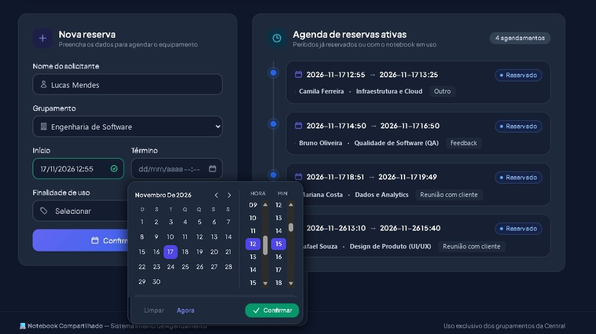
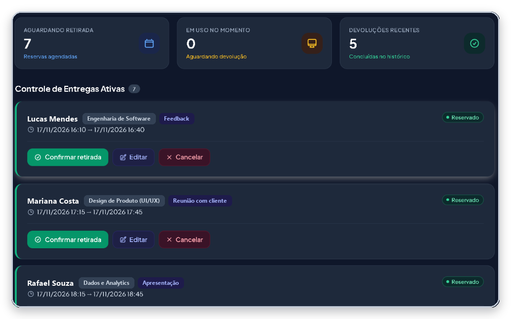
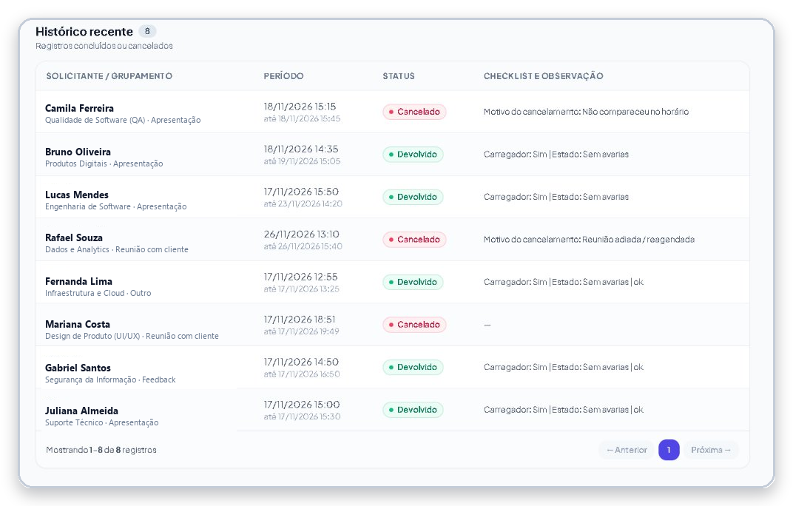

# 💻 Sistema de Reserva de Notebook Compartilhado

<p align="center">
  Aplicação web leve e moderna desenvolvida em <strong>Python (Flask + SQLite)</strong> e <strong>Tailwind CSS</strong> para gerenciamento centralizado de empréstimos, retiradas e devoluções de notebook compartilhado entre os grupamentos de uma Central.
</p>

<p align="center">
  
  
  
  
</p>

---

## 📸 Visão Geral do Sistema

### 1. Página Principal — Solicitação de Reserva e Agenda em Tempo Real (Modo Claro)
Interface intuitiva onde o colaborador visualiza a disponibilidade imediata do equipamento, preenche sua reserva e consulta a linha do tempo de agendamentos ativos.


### 2. Seletor de Data/Hora Inteligente e Modo Escuro
Calendário customizado com bloqueio de datas retroativas, botão de confirmação (**✓ Confirmar**) e suporte nativo a **Modo Escuro (Dark Mode)**.



### 3. Painel do Administrador — KPIs e Controle de Entregas Ativas
Área restrita protegida por login e senha para confirmar retiradas, editar dados de agendamentos ou cancelar reservas mediante justificativa.



### 4. Histórico Recente Auditável e Paginação
Registro completo de todas as devoluções (com checklist de carregador e estado físico do equipamento) e dos motivos de cancelamento, com paginação integrada.



---

## ✨ Principais Funcionalidades

### Para os Solicitantes
- **Indicador de Disponibilidade ao Vivo:** Banner superior informando em tempo real se o equipamento está *Disponível para agendamento* ou *Em uso no momento*.
- **Seletor de Data e Hora com Confirmação (`✓ Confirmar`):**
  - Bloqueio automático de dias e horários passados (retroativos).
  - Sugestão automática de horário de término (+30 minutos após o início selecionado).
  - Formatação no padrão brasileiro (`DD/MM/AAAA HH:MM`).
- **Prevenção de Conflitos e Zero Retrabalho:**
  - Validação atômica no banco (`BEGIN IMMEDIATE`) impedindo agendamentos sobrepostos.
  - Caso o horário escolhido já esteja ocupado, o sistema **mantém os campos Nome, Grupamento e Finalidade preenchidos**, solicitando apenas uma nova data ou horário.
- **Agenda em Linha do Tempo Paginada:** Lista os agendamentos ativos com badges semânticos (*Reservado* em verde e *Em uso* em âmbar).
- **Alternância de Tema (Claro / Escuro):** Preferência salva automaticamente no navegador (`localStorage`).

### Para o Administrador (`/admin`)
- **Autenticação por Sessão (`/login`):** Bloqueia o acesso ao painel e às rotas administrativas para usuários não autenticados.
- **Cards de Resumo (KPIs):** Contadores em tempo real de reservas *Aguardando Retirada*, *Em Uso no Momento* e *Devoluções Concluídas*.
- **Confirmação de Retirada:** Registra a data e hora exatas em que o notebook foi entregue ao solicitante.
- **Edição de Agendamento:** Permite ao administrador corrigir *Solicitante*, *Grupamento*, *Finalidade*, *Início* ou *Término* diretamente no card, validando conflitos e ignorando o próprio registro editado.
- **Cancelamento com Justificativa Obrigatória:** Modal moderno com preenchimento obrigatório do motivo do cancelamento e sugestões rápidas (*"Solicitação do usuário"*, *"Reunião adiada"*, *"Não compareceu"*).
- **Checklist de Devolução:** Ao receber o equipamento de volta, registra:
  - 🔌 Se o **carregador** foi devolvido (`Sim` / `NÃO`)
  - ✨ Se o equipamento está **sem avarias** (`Sem avarias` / `COM AVARIAS`)
  - 📝 Observações adicionais opcionais.
- **Paginação Completa:** Paginação independente nas seções *Controle de Entregas Ativas* e *Histórico Recente* (10 registros por página).
- **Funcionamento 100% Offline na Intranet:** O runtime do Tailwind CSS e todas as ilustrações SVG estão incluídos localmente em `/static`, não dependendo de acesso externo à internet.

---

## 🏢 Setores / Grupamentos Configurados (Exemplo)

O sistema vem configurado com setores fictícios de exemplo (personalizáveis via variável `GRUPAMENTOS` no `.env` ou diretamente na lista `_GRUPAMENTOS_PADRAO` em `app.py`):
1. Engenharia de Software
2. Design de Produto (UI/UX)
3. Infraestrutura e Cloud
4. Qualidade de Software (QA)
5. Dados e Analytics
6. Segurança da Informação
7. Suporte Técnico
8. Produtos Digitais
9. Comercial e Parcerias
10. Financeiro e Administrativo

---

## 🗂️ Estrutura do Projeto

```text
reservar_notebook/
├── app.py                        # Aplicação Flask, rotas, validações e conexão SQLite
├── requirements.txt              # Dependências Python (Flask >= 3.0)
├── iniciar.bat                   # Script Windows para verificar dependências e iniciar o servidor
├── .env.example                  # Exemplo de variáveis de ambiente (caminho do banco e credenciais)
├── .gitignore                    # Proteção para não versionar bancos (.db), .env ou arquivos locais
├── templates/
│   ├── base.html                 # Layout base, navbar glassmorphism, tema claro/escuro e rodapé
│   ├── index.html                # Página inicial (Hero, formulário de reserva e agenda paginada)
│   ├── login.html                # Tela de login do Painel do Administrador
│   ├── alan.html                 # Painel do Administrador (KPIs, entregas, edição, modal e histórico)
│   └── partials/
│       ├── badge.html            # Macros Jinja2 para badges de status e formatação de data pt-BR
│       └── toasts.html           # Notificações flutuantes (toasts) com barra de progresso
├── static/
│   ├── css/
│   │   └── style.css             # Variáveis de cores, animações suaves e acessibilidade
│   ├── js/
│   │   ├── main.js               # Tema, menu mobile, toasts, seletor de data/hora e spinners
│   │   └── tailwind.min.js       # Runtime local do Tailwind CSS (suporte offline)
│   └── img/
│       ├── favicon.svg           # Ícone da aba do navegador
│       ├── hero-notebook.svg     # Ilustração do banner principal
│       ├── empty-calendar.svg    # Ilustração para estados vazios
│       └── admin-shield.svg      # Ilustração de segurança da tela de login
└── docs/
    └── screenshots/              # Capturas de tela utilizadas na documentação
```

---

## 🚀 Como Executar o Projeto

### Pré-requisitos
- **Python 3.10+** instalado (no Windows, marque a opção *"Add Python to PATH"* ou instale via `winget install Python.Python.3.12`).

### 1. Clonar o repositório
```bash
git clone https://github.com/eltoncelestino/reservar-notebook.git
cd reservar-notebook
```

### 2. Configurar variáveis de ambiente (Opcional)
Copie o arquivo `.env.example` para `.env` e personalize conforme seu ambiente (como o diretório do banco de dados em rede e a senha do administrador):
```bash
cp .env.example .env
```

Variáveis suportadas no `.env`:
| Variável | Descrição | Valor Padrão |
| :--- | :--- | :--- |
| `SECRET_KEY` | Chave de assinatura da sessão Flask | `altere-esta-chave-em-producao` |
| `DB_DIR` | Pasta onde o arquivo SQLite será salvo (local ou caminho UNC de rede) | Diretório do projeto (`.`) |
| `DB_NAME` | Nome do arquivo do banco de dados SQLite | `db_reservar_notebook.db` |
| `ADMIN_USUARIO` | Usuário de acesso ao Painel do Administrador | `admin` |
| `ADMIN_SENHA` | Senha de acesso ao Painel do Administrador | `admin123` |

### 3. Instalar dependências e iniciar
No **Windows**, basta dar duplo clique em **`iniciar.bat`** (ele verifica/instala o Flask automaticamente e abre o navegador).

Ou manualmente via terminal:
```bash
pip install -r requirements.txt
python app.py
```

### 4. Acessar no navegador
- **Página do Solicitante:** `http://localhost:5000/sistema-reservar-notebook` (ou `http://NOME-DA-MAQUINA:5000/sistema-reservar-notebook` para outros usuários na mesma rede)
- **Painel do Administrador:** `http://localhost:5000/admin`

> 💡 **Acesso em Rede Local:** Para permitir que outras máquinas da mesma rede acessem o servidor na porta `5000`, libere a porta no Firewall do Windows (PowerShell como Administrador):
> ```powershell
> New-NetFirewallRule -DisplayName "Sistema Reserva Notebook (Porta 5000)" -Direction Inbound -LocalPort 5000 -Protocol TCP -Action Allow
> ```

---

## 🔒 Segurança e Privacidade no Repositório

Este repositório está configurado com `.gitignore` para garantir que **nenhum dado sensível** seja enviado ao controle de versão:
- Bancos de dados SQLite (`*.db`, `*.sqlite`, `*.sqlite3`) contendo nomes e históricos de reservas são ignorados.
- Arquivos `.env` com caminhos de servidores internos e credenciais reais não são versionados.
- Arquivos de apresentação (`*.pptx`), pacotes locais (`*.zip`) e atalhos de máquina (`*.url`) são ignorados.
